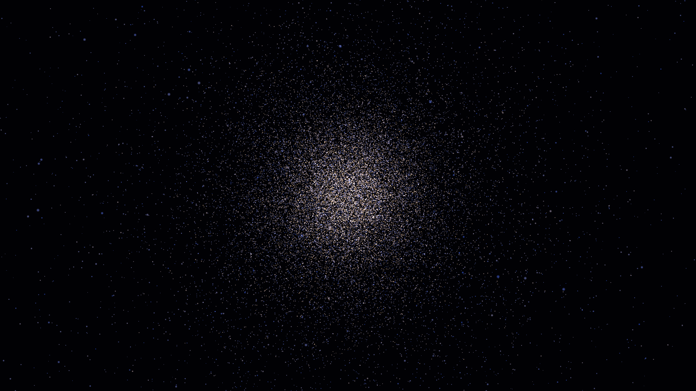

# NBodyProblemSim

Gravitational N-body simulation in CUDA, tuned for one machine (RTX 4080 SUPER, sm_89),
with a study of GPU load-balancing techniques. Master's course project, Technical University of Sofia, Plovdiv Branch, Faculty of Electronics and Automation (FEA).

## Build

Needs CUDA 13.4 and VS 2026 Insiders with the C++ workload (CMake and Ninja are bundled).

```bat
tools\build.bat Release
```

**Visual Studio 2026 (Insiders):** File → Open → Folder… → `D:\NBodyProblemSim`. VS reads
`CMakePresets.json`. Pick **x64 Release**, then select `nbody_viewer.exe` or `nbody_bench.exe` as
the startup item and press F5. The build output goes to `out/build/<preset>/`. The CUDA 13.4 VS
integration is installed, so `.cu` files get syntax highlighting and Nsight menus.

**Reading order for studying the code:** `src/core/nbody.h` → `interaction.cuh` →
`kernels_allpairs.cu` → `kernels_multi.cu` → `kernels_tree.cu` (with `docs/03-design.md`
§10–§16). `src/bench/main.cpp` is the measurement and validation harness.

## Run

```bat
build\nbody_bench.exe --list
build\nbody_bench.exe --kernel allpairs_tiled --n 131072 --runs 10 --csv results\run.csv
build\nbody_bench.exe --kernel allpairs_tiled --n 4096 --steps 2000 --energy
build\src\viewer\nbody_viewer.exe --n 65536
```

Viewer controls: LMB drag orbit · wheel zoom · `1`..`9` kernel · Space pause ·
`+`/`-` steps per frame · `[` `]` brightness · `R` reset · `V` vsync · Esc quit.
`--frames F --screenshot out.bmp` renders F frames, saves the last one and exits (for figures).



## Layout

| Path | What |
|---|---|
| `docs/` | requirements, hardware, approach, decisions, design |
| `references/` | verified papers + NVIDIA docs (literature-scout) |
| `src/core/` | kernels, integrator, initial conditions (`nbody_core` lib) |
| `src/bench/` | benchmark/validation CLI |
| `src/viewer/` | CUDA-OpenGL interop viewer (GLFW + glad) |
| `third_party/` | vendored GLFW 3.4 + glad (pinned, see its README) |
| `results/` | benchmark sessions: env + CSV + summary |
| `.claude/agents/` | role agents: architect, scout, critic, profiler, writer |
